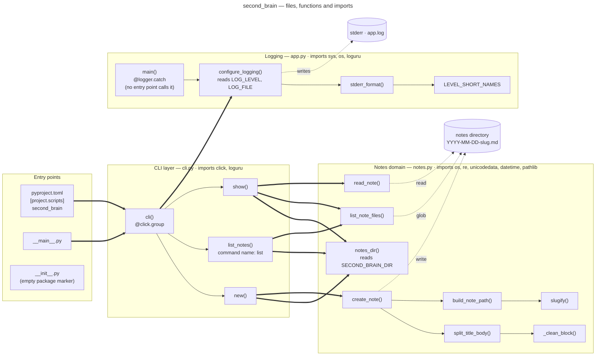
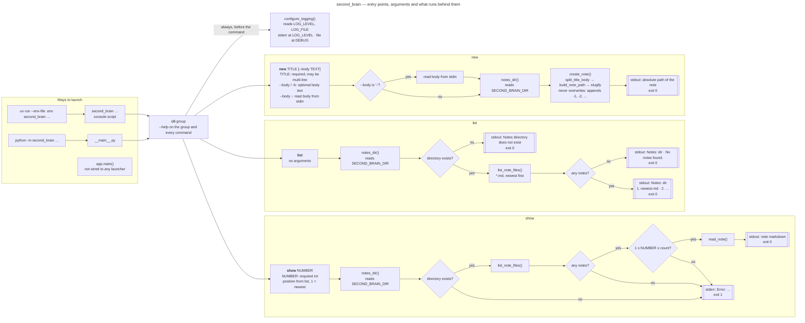

# Architecture

Three views of the `second_brain` package: how its files and functions fit
together, how it is launched, and what a typical session looks like.

## Package overview

Every module in `src/second_brain/`, grouped into components, with the
functions each one defines and how they import and call each other.

| Line style | Meaning |
|------------|---------|
| `==>` thick | Cross-module import, then a call (`from second_brain.x import y`) |
| `-->` solid | Call within the same module, or a Click subcommand of the group |
| `-.->` dotted | File I/O: log output and the notes directory |

| Module | Imports from the package | Third-party | Tested by |
|--------|--------------------------|-------------|-----------|
| `__main__.py` | `cli.cli` | — | — (excluded from coverage) |
| `cli.py` | `app.configure_logging`, `notes.create_note`, `notes.list_note_files`, `notes.notes_dir`, `notes.read_note` | `click`, `loguru` | `tests/test_cli.py` |
| `notes.py` | — | — | `tests/test_notes.py` |
| `app.py` | — | `loguru` | `tests/test_app.py` |

`notes.py` and `app.py` never import each other, and neither imports `cli.py`,
so dependencies only point from the CLI layer inwards.

## Entry points and arguments

The ways to start the program, the arguments each command takes, and the steps
and exit paths behind every command.

| Variable | Default | Read by |
|----------|---------|---------|
| `SECOND_BRAIN_DIR` | `~/second_brain/` | `notes_dir()`, on every call |
| `LOG_LEVEL` | `INFO` | `configure_logging()`, stderr sink only |
| `LOG_FILE` | `app.log` | `configure_logging()`, file sink always logs at `DEBUG` |

A missing `TITLE` or `NUMBER`, or a `NUMBER` that is not an integer, is
rejected by Click before any of these steps run (exit status 2).

## Example user flow

Capturing an idea, finding it again later and reading it back, including the
most common mistake: asking for a number that `list` did not show.

```mermaid
---
title: second_brain — capture, find and read a note
---
flowchart LR
    idea(["An idea pops up"])
    kind{"How much is there<br/>to write down?"}
    new_quick["second_brain new 'Caching idea'"]
    new_body["second_brain new 'Caching idea'<br/>--body 'Use an LRU. Check limits.'"]
    new_pipe["cat draft.md #124; second_brain new 'Draft' --body -"]
    saved[["stdout<br/>/home/you/second_brain/2026-10-25-caching-idea.md"]]
    note_file[("2026-10-25-caching-idea.md<br/>#35; Caching idea<br/>Use an LRU. Check limits.<br/>2026-10-25T09:30:00")]

    later(["Later: find it again"])
    list_cmd["second_brain list"]
    listing[["Notes: /home/you/second_brain<br/>1. 2026-10-25-draft.md<br/>2. 2026-10-25-caching-idea.md"]]
    show_cmd["second_brain show 2"]
    valid{"Number shown<br/>by list?"}
    content[["stdout: the note's markdown"]]
    reuse(["Read it, or pipe it on<br/>second_brain show 2 #124; less"])
    error[["stderr: Error: Note 9 not found.<br/>Only 2 notes available.<br/>exit 1"]]

    idea --> kind
    kind -->|"a title"| new_quick
    kind -->|"title and details"| new_body
    kind -->|"a draft file"| new_pipe
    new_quick & new_body & new_pipe --> saved --> note_file
    note_file --> later --> list_cmd --> listing --> show_cmd --> valid
    valid -->|yes| content --> reuse
    valid -->|"no, e.g. show 9"| error
    error -.->|"check the numbers again"| list_cmd
```

